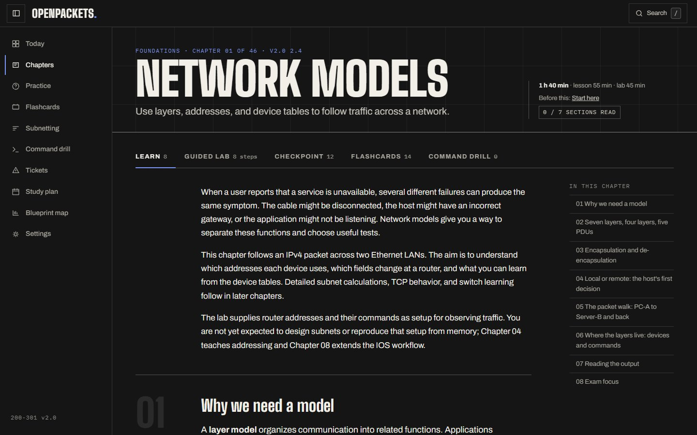
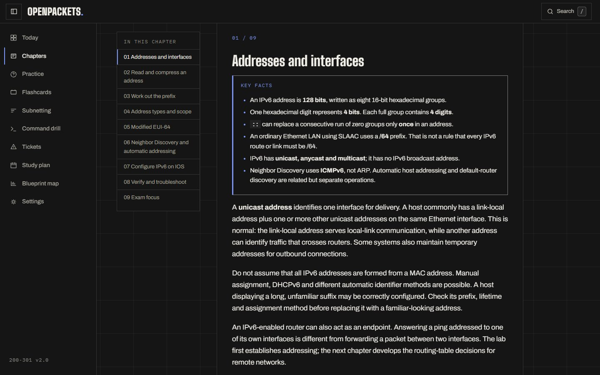
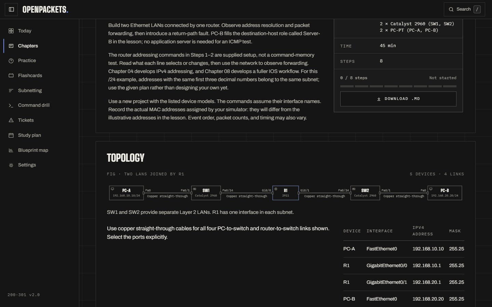
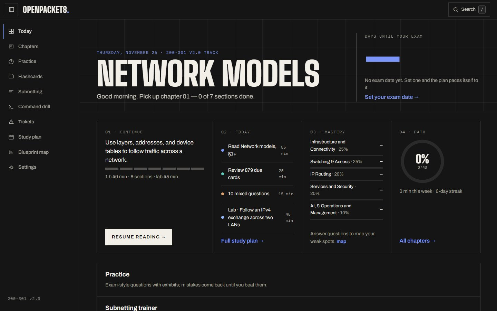

<h1 align="center">OpenPackets</h1>

<p align="center">
  A free, open-source study hub for the Cisco CCNA 200-301 exam: lessons, guided labs and practice, all in the browser.
</p>

<p align="center">
  <a href="https://github.com/otomop/open-packets/actions/workflows/ci.yml"></a>
  <a href="LICENSE.md"></a>
  <a href="LICENSE.md"></a>
</p>

<p align="center">
  <a href="https://otomop.github.io/open-packets/"><strong>Open the app</strong></a> ·
  <a href="https://github.com/otomop/open-packets/issues">Report an issue</a> ·
  <a href="#help-improve-it">Contribute a correction</a> ·
  <a href="LICENSE.md">License</a>
</p>

<p align="center">
  <a href="https://otomop.github.io/open-packets/"></a>
</p>

<p align="center">
  
  
</p>

> [!IMPORTANT]
> **Work in progress · AI disclosure**
>
> This project was created with Astra and Claude, with much of the work using the highest available settings. Those settings do not guarantee accuracy. Lessons, labs, questions, and answers may contain errors, omissions, or inconsistencies.
>
> Use this as a study companion, not an authoritative reference or a guarantee of passing. Check explanations and commands against official Cisco documentation and the exam topics for your exam version.

## About

OpenPackets is a self-study course for the CCNA 200-301 exam that runs as a static web page. It covers both exam versions: v1.1, which can be taken until 2 February 2027, and v2.0, which starts on 3 February 2027. Pick a version and an exam date, and the app marks which chapters you need and paces a weekly plan.

There is no account and no server. Your progress is saved in your browser, and you can export it to a file.

## What's inside

| | What you get | How much |
|---|---|---|
| **Lessons** | Chapters in nine parts, from network models to automation, each split into short sections with diagrams and key facts | 46 chapters |
| **Guided labs** | A step-by-step Packet Tracer lab in every chapter, with a topology, the commands to type and what you should see | 46 labs |
| **Practice** | Exam-style questions with an explanation for every option. Questions you miss come back until you get them right | 1,009 questions |
| **Flashcards** | Spaced repetition: grade each card and it returns when you are about to forget it | 1,012 cards |
| **Command drill** | Type the IOS command for a task, with the prompt and mode shown | 245 drills |
| **Tickets** | Troubleshooting scenarios: read the evidence, then name the cause | 94 tickets |
| **Subnetting trainer** | Generated IPv4 and IPv6 problems with a worked walkthrough for each | Unlimited |
| **Study plan and blueprint map** | A weekly plan paced to your exam date, and every exam objective linked to the chapters that teach it | Both exam versions |



## Quick start

The app is live at <https://otomop.github.io/open-packets/>. To run it on your own computer you need Node.js 20 or later.

```bash
git clone https://github.com/otomop/open-packets.git
cd open-packets
npm ci
npm start
```

Open <http://localhost:5173> once the server is ready. Keep the terminal open while you study; <kbd>Ctrl</kbd>+<kbd>C</kbd> stops it.

| Key | Action |
|---|---|
| <kbd>/</kbd> | Search chapters, sections, commands and objectives |
| <kbd>m</kbd> | Show or hide the side menu |
| <kbd>Space</kbd> | Flip a flashcard |
| <kbd>1</kbd> to <kbd>4</kbd> | Grade a flashcard, or pick an answer |
| <kbd>Enter</kbd> | Check an answer, or go to the next question |
| <kbd>?</kbd> | List the shortcuts |

## Your progress

Progress lives in your browser's storage for the address you study at, so the hosted app and a local copy each keep their own. To move between them, or to another device, use **Settings → Export progress** and import the file at the new location. Clearing site data deletes progress, so export a backup first.

Settings also has four themes, an accent color, and a switch that turns animation off.

## Project structure

```
open-packets/
├── content/               the course: plain files, no build step needed to edit
│   ├── chapters/          one folder per chapter
│   │   └── 01-network-models/
│   │       ├── chapter.md        the lesson
│   │       ├── lab.md            the guided lab
│   │       ├── questions.json    practice questions
│   │       ├── cards.json        flashcards
│   │       ├── commands.json     command drills
│   │       └── tickets.json      troubleshooting tickets
│   ├── blueprint.json     Cisco's exam objectives for v1.1 and v2.0
│   └── course.json        parts, domains and exam facts
├── src/                   the app: React and TypeScript
│   ├── pages/             one file per screen
│   ├── components/        shell, lab manual, diagrams
│   ├── lib/               progress store, scheduler, subnet maths, router
│   └── styles/            the design system
├── scripts/               content validation, tests, README screenshots
└── public/                fonts and license texts
```

Each lesson and practice bank is loaded only when you open it, so the first page stays small.

## Development

```bash
npm run dev         # development server with live reload, on http://127.0.0.1:5173
npm run typecheck   # TypeScript
npm test            # unit and rendering tests
npm run build       # validate the course content, then build to dist/
npm run shots -- http://127.0.0.1:5173   # retake the README screenshots (server running)
```

`npm run build` validates the course content first and stops on problems such as a diagram link to a device that does not exist or an unclosed code block. It also runs the command-drill content tests.

Every pull request, and every push to `main`, runs the type check, the tests and the build (`.github/workflows/ci.yml`). Publishing is manual: **Actions → Publish OpenPackets → Run workflow** on `main`. Pushing a commit alone does not update the live app.

## Help improve it

Found incorrect data, an unclear explanation or an inconsistency? Please open a pull request with the affected chapter or exercise, your correction, and a credible source that supports it. An [issue](https://github.com/otomop/open-packets/issues) is welcome if you are unsure how to make the change.

Course material is in [`content/chapters/`](content/chapters/), grouped by chapter as shown above.

## License

Code: **MIT**. Original course material: **CC BY 4.0**. See [LICENSE.md](LICENSE.md) for the scope of each and for third-party notices.

OpenPackets is independent and is not affiliated with or endorsed by Cisco. The exam objectives in `content/blueprint.json` are Cisco's wording and are not relicensed by this project.
